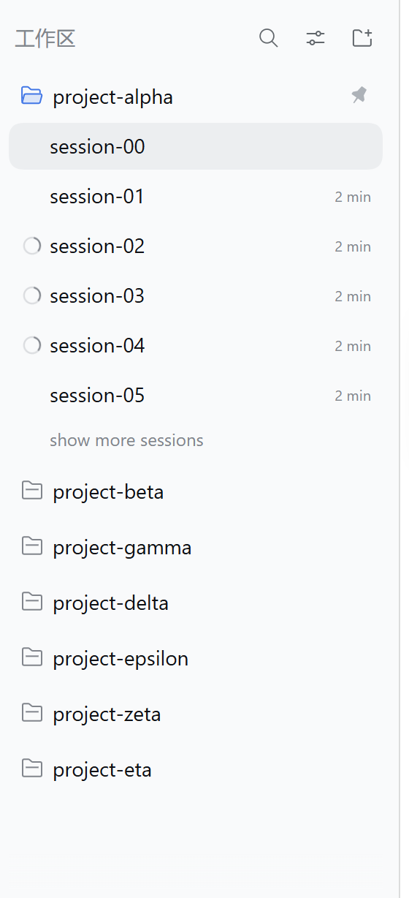
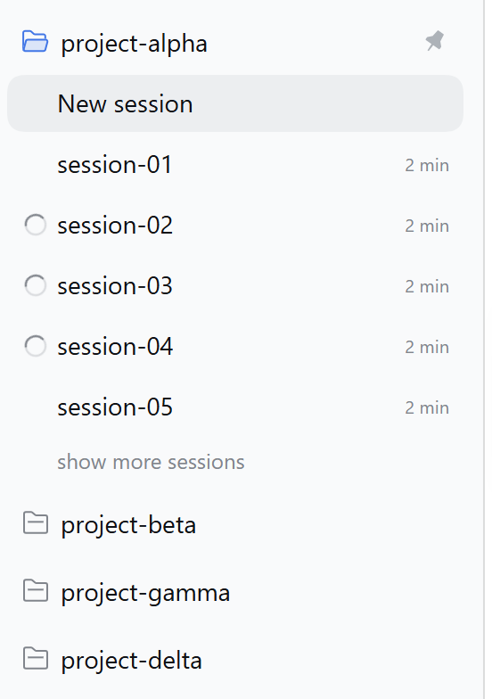
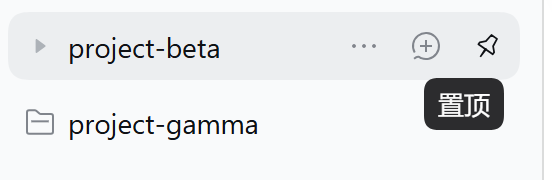
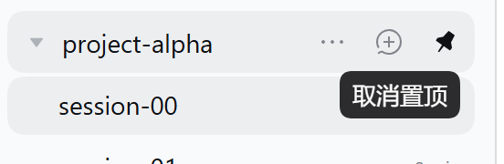

# dsh-workspace-pin

English | [中文](README.md)

[](https://github.com/Richard2091/dsh-workspace-pin/releases)
[](https://www.npmjs.com/package/@deepseek-ai/dsh)
[]()
[](LICENSE)

A pin for the **workspace (folder) rows** of the DeepSeek Harness (DSH) Web sidebar that looks and behaves **exactly like the official session pin**: hover reveals the same 16×16 button, a pinned row keeps a gray filled pin at rest, the tooltip is the official one, and clicking pins the workspace to the top.

The pin set is **persisted host-side** (just like session pins), so it survives **switching browsers, clearing site data, incognito windows and other devices**. Styling and interaction reuse the official implementation, and **no dsh source is modified** (dsh upgrades won't overwrite it).



## Why

Session rows in the DSH sidebar already have a pin: hover reveals a button, click to keep the session on top, and a small gray filled pin marks the row at rest. **Workspace (folder) rows don't** — they can only be reordered by dragging, and newly created workspaces get inserted at the top.

This plugin adds the same pin to workspace rows, reusing the official implementation instead of inventing a second style:

- the same official button class (`*_iconButton` from `Rows.module.css`) and the same `IconPinOutline/IconPinFill` artwork;
- the same 16×16 box, `--dsw-radius-xs` radius, `label-tertiary` rest color, `label-primary` on hover, and **no hover background**;
- the same official `Tooltip` (`side: bottom`, `align: end`, `delayMs: 500`, `portal: true`);
- when pinned and not hovered, a **gray filled pin** with the same metrics/colors as the official `*_pinIndicator`, hiding on hover to make room for the button;
- the pin set lives on the host, i.e. **the same "host-persisted, shared across browsers" model as session pins**.

## Screenshots

| Pinned, no hover | Hover an unpinned workspace |
|---|---|
|  |  |

| Hover a pinned workspace (unpin) | Sidebar overview |
|---|---|
|  |  |

## Parity with the official session pin

| Item | Official session pin | This plugin (workspace pin) |
|---|---|---|
| Button class | `*_iconButton` from `Rows.module.css` | Reuses the exact class of the sibling official buttons |
| Size / radius | 16×16 / `--dsw-radius-xs` | Same |
| Rest / hover color | `label-tertiary` / `label-primary` | Same |
| Hover background | Transparent (none) | Same |
| Icon | 14px `IconPinOutline` / `IconPinFill` | Same (official components) |
| Tooltip | Official `Tooltip` (bottom / end / portal / 500ms) | Same (official component) |
| Pinned rest marker | `*_pinIndicator`: 16×20, `label-caption`, 14px filled | Same metrics and colors |
| Marker hidden on row hover | Yes | Yes |
| **Pinned data location** | Host workspace registry (`pinnedSessionIds` in `workspace.json`) | Host state file (`<DSH_HOME>/storages/dsh-workspace-pin/state.json`) |
| **Cross-browser / cache clear** | Consistent, nothing lost | Consistent, nothing lost |

> The only implementation difference: the official marker uses `margin-left: 6px` because
> session rows have `gap: 0`; workspace rows already have `gap: 6px`, so this plugin uses
> `margin-left: 0` and lets the row gap provide the same 6px. Measured spacing to the
> previous element and to the row's right padding matches exactly.

## Install

### Windows (PowerShell)

```powershell
git clone https://github.com/Richard2091/dsh-workspace-pin.git
cd dsh-workspace-pin
pwsh -File .\install.ps1
```

> Windows PowerShell 5.1 works too: `powershell -ExecutionPolicy Bypass -File .\install.ps1`
> (the scripts are saved as UTF-8 with BOM, so 5.1 doesn't misread the Chinese comments as ANSI).

### macOS / Linux

```sh
git clone https://github.com/Richard2091/dsh-workspace-pin.git
cd dsh-workspace-pin
sh install.sh
```

### Manual

The installer only touches three places (the first two are backed up to `~/.dsh-backup-<timestamp>/`):

1. copy this package to `<profile>/plugins/dsh-workspace-pin` (`<profile>` is usually `~/.dsh/profiles/web`);
2. create a junction / symlink at `<profile>/node_modules/dsh-workspace-pin` pointing to it;
3. append the `insert` block from this repo's `cordis.patch.yml` to `<profile>/cordis.patch.yml`.

Then refresh the DSH Web page. The profile config and plugin files are reconciled by the host HMR; the host half only registers one state route, so a `dsh web` restart is normally unnecessary (restart once if the host didn't hot-load the new files). Check `window.__dshWorkspacePinVersion` in DevTools — it should read `"0.3.0"`; `window.__dshWorkspacePinStorageMode === "host"` means the host state store is connected.

**Known pitfall**: running `pnpm install` inside the profile wipes the symlink from step 2 (a DSH quirk). Just re-run the installer (it is idempotent).

## Usage

- Hover any workspace row → a pin button appears at the row end (rightmost, next to the official "…" and "+");
- Click → pin the workspace to the top; click again to unpin (unpinning does **not** restore the old position);
- The pin set is stored **on the host**, so every browser/device connected to the same DSH sees the same pins: switching browsers, incognito windows or clearing site data loses nothing;
- The workspace order itself is written to the host registry through the official `ctx.workspaces.insertBefore()` client service, so it survives reloads and restarts;
- On page load, whenever the workspace list changes, and when the page becomes visible again, pinned workspaces are moved back to the top (a newly created workspace inserted by the host won't push them down).

### Where the data lives / resetting

| Data | Location |
|---|---|
| Workspace pin set | `<DSH_HOME>/storages/dsh-workspace-pin/state.json` (default `~/.dsh/storages/dsh-workspace-pin/state.json`) |
| Workspace display order | Host workspace registry (`global.workspaceIds` in `~/.dsh/storages/workspace.json`, shared with official drag ordering) |
| Browser localStorage | **Cache only** (key `dsh.workspace-pin.v1`): first-paint hint and legacy-data migration source, never the source of truth |

Reset: delete `state.json` and refresh (or POST `{"op":"set","pinned":[]}`). You can also move the state file with the entry config:

```yaml
- insert:
    - id: workspace-pin
      name: 'dsh-workspace-pin'
      config:
        stateFile: 'D:\dsh-data\workspace-pin.json'
```

## How it works

**Host half** (`lib/index.js`):

- registers one **exact route** with the official `ctx.webServer.register()`:
  `GET|POST /plugins/dsh-workspace-pin/state`;
- admission reuses the official `ctx.connection.requestRejection()` (Host/Origin fence +
  browser-session auth): unauthenticated requests get 401, cross-origin writes get 403;
- the state file defaults to `<DSH_HOME>/storages/dsh-workspace-pin/state.json` and is
  written atomically (temp file + rename); `pin`/`unpin` are **incremental operations**
  serialized by the host, so concurrent pins from multiple browsers never clobber each
  other (`set` is only used for migration);
- no extra dependencies (Node built-ins only).

**Browser half** (`lib/client.js`):

- paints from the localStorage cache on first frame, then aligns with the host via `GET`
  (the host is the source of truth);
- on click, updates the UI immediately (optimistic), then `POST {op:"pin"|"unpin"}` and
  corrects the UI with the authoritative set returned by the host; failures only warn and
  fall back to cache mode without undoing the local action;
- re-aligns with the host when the page becomes visible again (another browser/tab may have
  changed the pins);
- the hover button reuses the official class and renders through the platform module table's
  official React / `Tooltip` / `IconPinFill` / `IconPinOutline`; if the official primitives
  are unavailable it falls back to an equivalent local style and native `title`;
- legacy upgrade: if the host is empty while this browser has an old localStorage pin set,
  it is migrated to the host once with `set`.

## Compatibility

- Tested on DSH **0.2.1-rc.2** (Web GUI). Depends on the official workspace row DOM, the
  `ctx.workspaces.insertBefore` client service, the `ctx.webServer` / `ctx.connection` host
  services, and the `react` / `react-dom/client` / `@deepseek-ai/dsh-client-ui-primitives`
  platform modules;
- Major dsh upgrades that change the row markup, CSS-module class names, the module table or
  those host services will need a matching plugin update;
- No dsh source modification and no fork; uninstalling restores the native sidebar.

## Known limitations

- Depends on the official DOM (`[data-row-key^="workspace:"]`, the trailing actions container)
  and on the `Rows.module.css` class names/metrics; official changes require an update here.
- Pinned workspaces are reordered on page load — that's a **real order write**, not a
  visual-only sort.
- The host state file and the host workspace registry are two separate stores: pins live in
  `storages/dsh-workspace-pin/state.json`, display order in `storages/workspace.json`.
  **Don't hand-edit either while `dsh web` is running** (in-memory state will overwrite
  them); copy the whole directory for backup/migration.
- If the host half isn't loaded (e.g. only the browser half was deployed, or the host hasn't
  hot-loaded it yet), the plugin falls back to localStorage cache mode
  (`window.__dshWorkspacePinStorageMode === "cache"`) and is no longer cross-browser; restart
  `dsh web` to recover.

## Uninstall

```powershell
pwsh -File .\uninstall.ps1   # Windows
```

```sh
sh uninstall.sh             # macOS / Linux
```

Or remove the three pieces manually (the `cordis.patch.yml` block, the `node_modules` link,
the plugin directory), then refresh the page. The workspace order already written to the host
is kept (drag it back if you want). The pin file
`storages/dsh-workspace-pin/state.json` is not removed automatically; delete it manually if
desired.

## License

[MIT](LICENSE)
