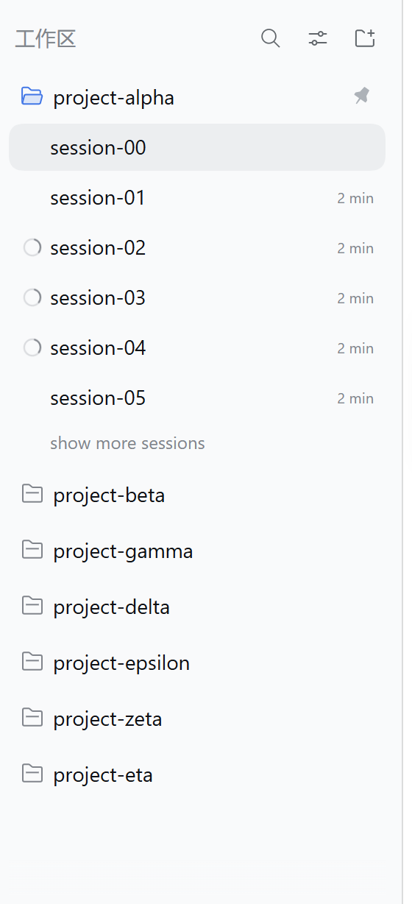
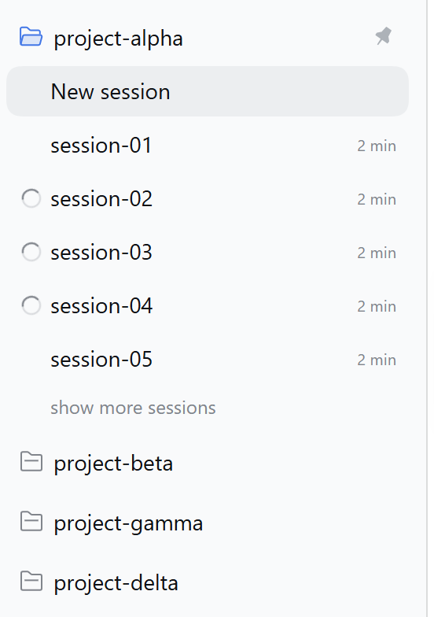
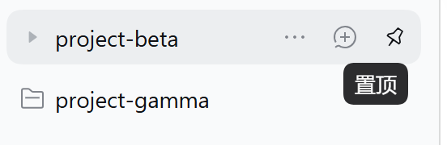
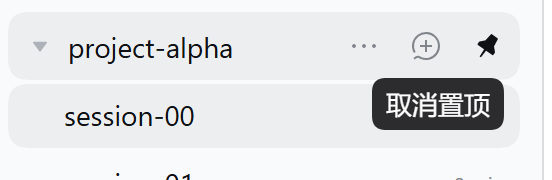

# dsh-workspace-pin

[English](README.en.md) | 中文

[](https://github.com/Richard2091/dsh-workspace-pin/releases)
[](https://www.npmjs.com/package/@deepseek-ai/dsh)
[]()
[](LICENSE)

给 **DeepSeek Harness（DSH）Web 侧栏的工作区（文件夹）行**补上一个**和会话置顶完全同款**的图钉：hover 出现 16×16 的官方同款按钮，置顶后无 hover 时留一枚灰色实心 pin，悬浮提示用官方 Tooltip；点一下把该工作区钉到列表最前。

置顶集合由**宿主半边**持久化（和会话置顶一样），所以**跨浏览器、清缓存、无痕窗口、换设备**都不丢；视觉与交互直接复用官方实现，**不改 dsh 自身任何文件**（dsh 升级不会覆盖）。



## 为什么做这个

dsh 的侧栏里，**会话行自带置顶按钮**：hover 出现，点一下把会话钉到最前；置顶后面板不再 hover 时，行尾留一枚灰色实心图钉作为状态提示。

**工作区（文件夹）行没有这个入口**——只能靠拖拽排序，而新建工作区又会被宿主前插到列表最前。本插件把「会话置顶」那套图钉原样补到工作区行上：

- 同一个官方按钮类名（`Rows.module.css` 的 `*_iconButton`）与同一套 `IconPinOutline/IconPinFill` 图形；
- 同样的 16×16 尺寸、`--dsw-radius-xs` 圆角、`label-tertiary` 静止色、hover 时只变 `label-primary`、**无 hover 背景**；
- 同样的官方 `Tooltip`（`side: bottom`、`align: end`、`delayMs: 500`、`portal: true`）；
- 置顶后无 hover 时，行尾出现与官方 `*_pinIndicator` 同度量、同配色的**灰色实心图钉**，行一 hover 就让位给悬浮按钮；
- 置顶数据落在宿主侧，**与会话置顶同一套“宿主持久化、浏览器共享”的模型**。

## 效果

| 置顶后（无 hover） | hover 未置顶的工作区 |
|---|---|
|  |  |

| hover 已置顶的工作区（取消置顶） | 侧栏总览 |
|---|---|
|  |  |

## 与会话置顶的一致性

| 项 | 官方「会话置顶」 | 本插件「工作区置顶」 |
|---|---|---|
| 按钮类名 | `Rows.module.css` 的 `*_iconButton` | 复用同行官方按钮的同一个类名 |
| 尺寸 / 圆角 | 16×16 / `--dsw-radius-xs` | 相同 |
| 静止色 / hover 色 | `label-tertiary` / `label-primary` | 相同 |
| hover 背景 | 透明（无） | 相同 |
| 图标 | 14px `IconPinOutline` / `IconPinFill` | 相同（官方组件） |
| 悬浮提示 | 官方 `Tooltip`（bottom / end / portal / 500ms） | 相同（官方组件） |
| 置顶静止标记 | `*_pinIndicator`：16×20、`label-caption`、14px 实心 | 同度量同配色 |
| 行 hover 时标记隐藏 | 是 | 是 |
| **置顶数据存放** | 宿主 workspace registry（`workspace.json` 的 `pinnedSessionIds`） | 宿主状态文件（`<DSH_HOME>/storages/dsh-workspace-pin/state.json`） |
| **跨浏览器 / 清缓存** | 一致，不丢 | 一致，不丢 |

> 唯一实现差异：官方静止标记用 `margin-left: 6px`（会话行 `gap: 0`），工作区行本身
> `gap: 6px`，所以插件把 `margin-left` 取 0，由行间距承担同样的 6px。实测两者
> 「标记到前一元素」的间距和「标记/按钮到行右内边距」的距离完全一致。

## 安装

### Windows（PowerShell）

```powershell
git clone https://github.com/Richard2091/dsh-workspace-pin.git
cd dsh-workspace-pin
pwsh -File .\install.ps1
```

> 只有 Windows PowerShell 5.1 也可以：`powershell -ExecutionPolicy Bypass -File .\install.ps1`
> （脚本按 UTF-8 BOM 保存，5.1 不会把中文注释按 ANSI 解析成乱码）。

### macOS / Linux

```sh
git clone https://github.com/Richard2091/dsh-workspace-pin.git
cd dsh-workspace-pin
sh install.sh
```

### 手动安装

安装脚本只动三处（前两处会先备份到 `~/.dsh-backup-<时间戳>/`）：

1. 把插件包复制到 `<profile>/plugins/dsh-workspace-pin`（`<profile>` 一般是
   `~/.dsh/profiles/web`）；
2. 在 `<profile>/node_modules/dsh-workspace-pin` 建一个指向它的 junction / 软链；
3. 把本仓库 `cordis.patch.yml` 里的 `insert` 块追加进 `<profile>/cordis.patch.yml`。

刷新浏览器里的 DSH Web 页面即生效（profile 配置与插件文件由宿主 HMR 重组，本插件
宿主半边只注册一条状态路由，通常不需要重启 `dsh web`；如果宿主没有热加载新文件，
重启一次即可）。控制台执行 `window.__dshWorkspacePinVersion`，期望 `"0.3.0"`；
`window.__dshWorkspacePinStorageMode` 为 `"host"` 表示已连上宿主状态。

**已知坑**：以后在 profile 里跑 `pnpm install` 会清掉第 2 步的软链，重跑一次安装脚本
即可（脚本幂等）。

## 使用

- hover 任一工作区行 → 行尾出现图钉按钮（在官方「…」和「+」旁边，最右）；
- 点一下 → 该工作区钉到列表最前；再点一下取消置顶（取消**不会**把工作区挪回原位）；
- **置顶集合存在宿主**，所有连到同一台 DSH 的浏览器/设备看到同一份置顶：
  换浏览器、无痕窗口、清站点数据都不会丢；
- 工作区顺序通过官方客户端服务 `ctx.workspaces.insertBefore()` 写入宿主 registry，刷新/重启后仍在；
- 页面加载、工作区列表变化、页面重新可见时会把已置顶的工作区重新排到最前——新建工作区被宿主前插时，置顶项仍回到顶部。

### 数据位置与重置

| 数据 | 位置 |
|---|---|
| 工作区置顶集合 | `<DSH_HOME>/storages/dsh-workspace-pin/state.json`（默认 `~/.dsh/storages/dsh-workspace-pin/state.json`） |
| 工作区显示顺序 | 宿主 workspace registry（`~/.dsh/storages/workspace.json` 的 `global.workspaceIds`，与官方拖拽排序同一份） |
| 浏览器 localStorage | 仅作**本地缓存/旧数据迁移源**（键 `dsh.workspace-pin.v1`），不是数据源 |

重置置顶：删掉 `state.json` 后刷新页面即可（或 POST `{"op":"set","pinned":[]}`）。
也可以用条目 config 的 `stateFile` 把状态文件指到别处：

```yaml
- insert:
    - id: workspace-pin
      name: 'dsh-workspace-pin'
      config:
        stateFile: 'D:\dsh-data\workspace-pin.json'
```

## 实现原理

**宿主半边**（`lib/index.js`）：

- 用官方 `ctx.webServer.register()` 注册一条**精确路由**
  `GET|POST /plugins/dsh-workspace-pin/state`；
- 请求准入复用官方 `ctx.connection.requestRejection()`（Host/Origin 围栏 + 浏览器会话
  鉴权），未认证请求 401、跨源写请求 403；
- 状态文件默认 `<DSH_HOME>/storages/dsh-workspace-pin/state.json`，写入走「临时文件 +
  rename」原子替换；`pin`/`unpin` 是**增量操作**，宿主串行化读改写，多浏览器并发置顶
  不会互相覆盖（`set` 仅用于旧数据迁移）；
- 不新增任何依赖（只用 Node 内置模块）。

**浏览器半边**（`lib/client.js`）：

- 首帧先用 localStorage 缓存把图钉画出来，随后 `GET` 宿主状态对齐；宿主是数据源；
- 点击时本地立即生效（乐观更新），再 `POST {op:"pin"|"unpin"}`，用宿主返回的权威集合
  校正 UI；失败只告警并退回本地缓存模式，不影响已生效的操作；
- 页面重新可见时再向宿主对齐一次（别的浏览器/标签页可能刚改过）；
- 悬浮按钮复用官方类名，并通过平台模块表用官方 React / `Tooltip` / `IconPinFill` /
  `IconPinOutline` 渲染；官方 UI 原语不可用时退回等价兜底样式与原生 `title`；
- 旧版本升级：若宿主为空而本机 localStorage 有旧置顶集合，会一次性 `set` 迁移到宿主。

## 兼容性

- 在 DSH **0.2.1-rc.2**（Web GUI）上实测；依赖官方工作区行 DOM、`ctx.workspaces.insertBefore`
  客户端服务、`ctx.webServer` / `ctx.connection` 宿主服务，以及平台模块表里的
  `react` / `react-dom/client` / `@deepseek-ai/dsh-client-ui-primitives`；
- dsh 大版本升级后如果官方行结构 / 类名 / 模块表 / 宿主服务变化，需要跟着适配；
- 不修改 dsh 源码，也不 fork dsh；卸载即恢复原生侧栏。

## 已知限制

- 依赖官方工作区行的 DOM 结构（`[data-row-key^="workspace:"]`、行尾 actions 容器）与
  `Rows.module.css` 的类名/度量；官方调整时需要同步更新插件。
- 页面加载时会把已置顶工作区排到最前，这是一次**真实的顺序写入**（不是纯视觉排序）。
- 宿主状态文件与宿主 workspace registry 是两份独立数据：置顶集合在
  `storages/dsh-workspace-pin/state.json`，显示顺序在 `storages/workspace.json`；
  **不要在 `dsh web` 运行时手改**这两个文件（会被内存状态覆盖），备份/迁移整目录拷贝即可。
- 若宿主半边没有加载（例如插件只装了浏览器半边、或宿主尚未热加载），插件会退回
  localStorage 缓存模式（`window.__dshWorkspacePinStorageMode === "cache"`），此时不跨浏览器；
  重启 `dsh web` 后恢复正常。

## 卸载

```powershell
pwsh -File .\uninstall.ps1   # Windows
```

```sh
sh uninstall.sh             # macOS / Linux
```

或手动删掉三处：`cordis.patch.yml` 里的安装块、`node_modules` 里的软链、`plugins` 里的
插件目录，然后刷新页面。已写入宿主的工作区顺序会保留（拖回去即可）；置顶集合文件
`storages/dsh-workspace-pin/state.json` 不会被自动删除，需要的话手动删。

## License

[MIT](LICENSE)
